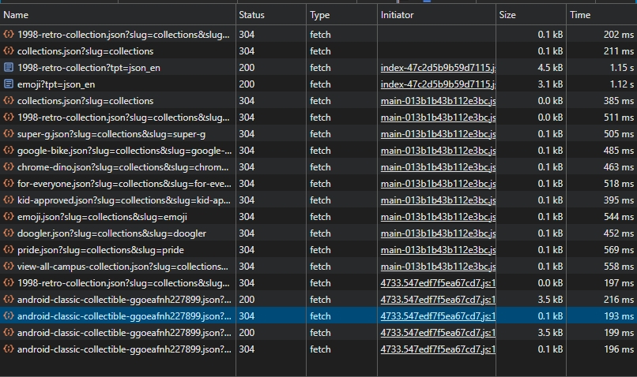
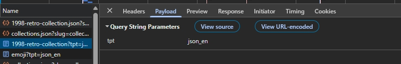

Домашняя работа № 1
Дисциплина: ОП.03 «Информационные технологии»

| Поле | Значение |
| :--- | :--- |
| Фамилия, имя | Перфильева Арина |
| Группа | РПО1 |
| Номер работы | 1 |
| Тема работы | Цифровая воронка: путь данных от ссылки до заявки |
| Дата сдачи | 11.09 |
| Ветка | hw-01 |

---

## 1. Какой сайт смотрел

| Поле | Значение |
| --- | --- |
| Название сайта | Google Merch Shop |
| Адрес | https://shop.merch.google/ |
| Откуда сайт | из списка в задании |

---

## 2. Три действия и что отправил счётчик

| № | Что я сделал на сайте | Название события (en) | Что ещё было в Payload |
| --- | --- | --- | --- |
| 1 | обновил страницу | `page_view` | `dl` (адрес страницы), `tpt` (тип страницы), `slug` (идентификатор коллекции) |
| 2 | прокрутил до низа | `scroll_end` | `position` (позиция скролла), `viewport` (размер видимой области), `slug` (текущая коллекция) |
| 3 | нажал на товар | `click_product` | `product_id` (идентификатор товара), `slug` (коллекция), `position` (позиция товара в выдаче) |

---

## 3. Путь пользователя: 5 шагов

| № | Мой шаг | Пример |
| --- | --- | --- |
| 1 | пользователь кликнул по ссылке на страницу коллекций | человек увидел ссылку в сообществе и нажал на неё |
| 2 | загрузилась страница с подборками товаров | открылась главная страница сайта |
| 3 | пользователь прокрутил страницу вниз, просматривая карточки товаров | он прокрутил до формы записи |
| 4 | кликнул на карточку товара для просмотра | начал заполнять: имя и телефон |
| 5 | после изучения карточки вернулся к просмотру коллекций (целевая заявка не отправлена) | нажал «Отправить», заявка ушла менеджеру |

---

## 4. Где данные могут потеряться

| № | На каком шаге | Что может потеряться |
| --- | --- | --- |
| 1 | когда грузится страница с коллекциями | не видно, реально ли человек смотрел подборки — браузер берёт всё из кэша, и система думает, что ничего не происходило |
| 2 | когда жмёшь на карточку товара | не фиксируется, какой именно товар заинтересовал — в логах только подгрузка коллекций, а про клик ничего нет |

---

## 5. Использование ИИ

| Вопрос | Ответ |
| --- | --- |
| Что сделал сам | Проанализировала Network‑панель: выписала запросы с коллекциями, статусами 304/200, параметрами slug и tpt; сопоставила с шагами пользователя |
| Что спросил у модели | Какие Name в панели Network нужны, на какие кликать, чтобы отследить путь пользователя и точки потери данных |