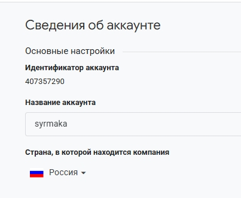
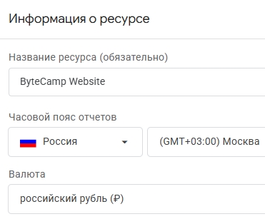
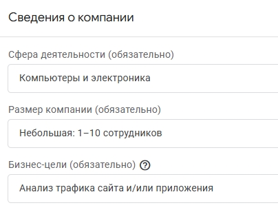
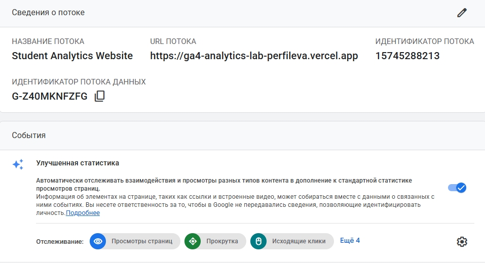

Домашняя работа № 2
Дисциплина: ОП.03 «Информационные технологии»

| Поле | Значение |
| :--- | :--- |
| Фамилия, имя | Перфильева Арина |
| Группа | РПО1 |
| Номер работы | 2 |
| Тема работы | Анализ воронки цифрового продукта и структура Google Analytics 4 |
| Дата сдачи | 19.09 |
| Ветка | hw-02 |

---

## Часть 1. Исследование воронки

### 1.1. Объект исследования

| Поле | Значение |
| --- | --- |
| Компания, сервис или отрасль | Маркетплейс Ozon (e-commerce) |
| Адрес сайта или приложения | ozon.ru |
| Целевое действие | Выкуп товара в пункте выдачи |
| Почему выбран этот объект | Путь пользователя на маркетплейсе хорошо оцифрован: каждый этап (от показа карточки до выкупа) сопровождается измеримыми метриками; часть данных публикуется Ozon для продавцов и в отраслевых отчётах (например, доля Ozon в общем количестве заказов на рынке e-commerce России во второй половине 2024 года — 21% по данным Data Insight) |

---

### 1.2. Воронка

| № | Этап | Что считается переходом дальше | Метрика этапа |
| --- | --- | --- | --- |
| 1 | Показ карточки в выдаче | Клик по карточке товара | Количество показов |
| 2 | Просмотр карточки товара | Добавление товара в корзину | Просмотр → корзина |
| 3 | Добавление в корзину | Оформление заказа | Корзина → заказ |
| 4 | Оформление заказа | Доставка в ПВЗ, приход покупателя | Процент выкупа |
| 5 | Выкуп товара в ПВЗ | Повторная покупка | Конверсия в повторную покупку |
| 6 | Повторная покупка | Регулярные заказы, отзывы | LTV (пожизненная ценность клиента) |

---

### 1.3. Источники

#### Источник 1

| Поле | Значение |
| --- | --- |
| Название материала | «Интернет торговля в России 2025» |
| Автор или организация | Агентство Data Insight |
| Дата публикации | Май 2025 |
| Прямая ссылка | https://datainsight.ru/DI_eCommerce_2025 |

**Выписка из материала** (ключевая мысль, цифра, наблюдение, результат):  
В 2024 году объём рынка розничной интернет‑торговли в России — 11,2 трлн рублей, 6,8 млрд заказов. Средний чек — 1 650 рублей (на 4 % ниже прошлогоднего). Доля Ozon во второй половине 2024 года — 21 % в общем количестве заказов и 23 % во всём объёме продаж.

**Что подтверждает и как связано с моей воронкой** (своими словами):  
Подтверждает масштаб рынка e‑commerce и значимость Ozon как объекта исследования. Доля заказов (21 %) и доля объёма продаж (23 %) отражают масштаб входящего трафика и коммерческой эффективности площадки — это характеризует верхний уровень воронки (охват и привлечение).

**Цифры из источника и этап воронки, к которому относятся:**  
- 21 % (доля заказов Ozon) — этап «Показ карточки в выдаче» (охват аудитории, вход в воронку).  
- 23 % (доля объёма продаж Ozon) — этап «Оформление заказа / выкуп» (конверсионная эффективность и денежный результат).  

---

#### Источник 2

| Поле | Значение |
| --- | --- |
| Название материала | «Почему покупатели бросают корзины в интернет‑магазинах: исследование RetailCRM и ЮKassa» |
| Автор или организация | RetailCRM и ЮKassa |
| Дата публикации | Август 2024 |
| Прямая ссылка | https://www.retailcrm.ru/blog/posts/issledovanie-o-broshennoy-korzine |

**Выписка из материала:**  
30 % покупателей используют корзины вместо списка желаний. 26 % клиентов вернутся за товарами в корзине при предложении скидки. С брошенными корзинами работают 71 % интернет‑магазинов. Выкуп корзины из email — около 2 %, из WhatsApp — до 4 % без стимула и до 8 % со скидкой (ограниченной 24 часами).

**Что подтверждает и как связано с моей воронкой:**  
Подтверждает наличие проблемы на этапе «Добавление в корзину → Оформление заказа». Данные раскрывают поведенческие причины оттока (корзина как вишлист) и потенциал возврата пользователей через триггерные коммуникации.

**Цифры из источника и этап воронки, к которому относятся:**  
- 30 % (корзина как список желаний) — этап «Добавление в корзину» (объясняет низкую конверсию в заказ).  
- 2–8 % (выкуп из рассылок) — этап «Оформление заказа» (показывает эффективность инструментов возврата на узком участке воронки).  
- 26 % (возврат при скидке) — этап «Оформление заказа» (демонстрирует потенциал стимулирования конверсии).  

---

#### Источник 3

| Поле | Значение |
| --- | --- |
| Название материала | «Стоимость конверсии в интернет‑рекламе выросла на 31%» |
| Автор или организация | Коммерсантъ |
| Дата публикации | 2025 |
| Прямая ссылка | https://www.kommersant.ru/doc/7532295 |

**Выписка из материала:**  
По итогам IV квартала 2024 года стоимость конверсии (CPA) в интернет‑рекламе выросла на 31 % год к году. В e‑commerce CPC вырос на 4,4 %, CPA — на 18 %. В 2025 году прогнозируется рост CPA примерно на 30 %.

**Что подтверждает и как связано с моей воронкой:**  
Подтверждает рост стоимости привлечения трафика на этапе «Показ карточки в выдаче → клик». Рост CPA делает критичной оптимизацию нижних этапов воронки: каждый потерянный пользователь на этапах «корзина → заказ» и «заказ → выкуп» обходится бизнесу дороже.

**Цифры из источника и этап воронки, к которому относятся:**  
- 31 % (рост CPA год к году) — этап «Показ карточки в выдаче» (удорожание привлечения, повышает ценность конверсии на последующих этапах).  
- 18 % (рост CPA в e‑commerce) — этап «Оформление заказа» (отражает общую динамику стоимости целевого действия).  
- 4,4 % (рост CPC) — этап «Показ карточки в выдаче → клик» (удорожание перехода из выдачи в карточку).  

---

#### Источник 4

| Поле | Значение |
| --- | --- |
| Название материала | «Воронка продаж» |
| Автор или организация | Ozon Seller Edu (платформа Ozon для продавцов) |
| Дата публикации | Не указана |
| Прямая ссылка | https://seller-edu.ozon.ru/libra/analytics-and-metrics/graphs/prodaji/voronka_prodazh |

**Выписка из материала:**  
Воронка продаж — инструмент с общей информацией о продажах и влияющих на них метриках. Позволяет оценить процент переходов между этапами покупки и выявить узкие места. Типы воронок: неделя к неделе, сквозная, пошаговая. Метрики: показы всего; показы в поиске и каталоге; конверсия из поиска в карточку; показы на карточке товара; конверсия из карточки в корзину; добавления из карточки в корзину; конверсия из корзины в заказ; заказано товаров; конверсия из заказа в выкуп; выкуплено товаров.

**Что подтверждает и как связано с моей воронкой:**  
Подтверждает структуру воронки продаж Ozon из первоисточника. Метрики напрямую соответствуют этапам воронки (показы → клики → корзина → заказ → выкуп) и связывают теоретическую модель с реальным инструментом аналитики платформы.

**Цифры из источника и этап воронки, к которому относятся:**  
- Показы всего / в поиске и каталоге — этап «Показ карточки в выдаче».  
- Конверсия из поиска в карточку — этап «Переход из выдачи в карточку товара».  
- Конверсия из карточки в корзину — этап «Добавление в корзину».  
- Конверсия из корзины в заказ — этап «Оформление заказа».  
- Конверсия из заказа в выкуп — этап «Выкуп заказа». 

---

#### Источник 5

| Поле | Значение |
| --- | --- |
| Название материала | «Как стать лидером категории по продажам на Ozon. Кейс крупного мебельного интернет‑магазина» |
| Автор или организация | Оборот.ру |
| Дата публикации | Март 2024 |
| Прямая ссылка | https://oborot.ru/articles/keis-ozon-18-i208799.html |

**Выписка из материала:**  
Контент‑рейтинг Ozon повышен до 80–100 %. Конверсия в добавление товара в корзину увеличилась на 15 %. ДРР снижен с 10 % до 7,8 %. Конверсия в заказ увеличилась на 10 %. Сроки доставки сокращены с 45 дней до 10–15 дней. Месячный оборот бренда на Ozon вырос почти в 5 раз.

**Что подтверждает и как связано с моей воронкой:**  
Подтверждает влияние качества контента и сроков доставки на конверсию по этапам воронки. Рост конверсии в корзину и заказ демонстрирует эффективность оптимизации карточек товара; сокращение сроков доставки позитивно влияет на этап выкупа.

**Цифры из источника и этап воронки, к которому относятся:**  
- 80–100 % (контент‑рейтинг) — этап «Просмотр карточки товара» (качество контента напрямую влияет на вовлечённость).  
- +15 % (конверсия в добавление в корзину) — этап «Добавление в корзину».  
- +10 % (конверсия в заказ) — этап «Оформление заказа».  
- С 45 до 10–15 дней (сроки доставки) — этап «Заказ → выкуп» (сокращение сроков повышает вероятность выкупа).  
- Снижение ДРР с 10 % до 7,8 % — этап «Привлечение трафика» (повышение эффективности рекламных расходов).  
- Рост оборота почти в 5 раз — итоговый результат оптимизации всей воронки.  

---

### 4. Реальные кейсы российского рынка

#### Кейс 1. «Много Мебели» на Ozon — оптимизация контента карточек и сроков доставки

| № | Пункт | Ответ |
| --- | --- | --- |
| 1 | Компания, продукт или рынок | «Много Мебели» — производитель мягкой и корпусной мебели, продажи на Ozon |
| 2 | Как выглядела воронка или её проблемный участок | Воронка: показы → клики → добавление в корзину → заказ → выкуп. Проблемные участки: этап «просмотр карточки → добавление в корзину» (низкий контент‑рейтинг, слабая визуализация) и этап «заказ → выкуп» (длительные сроки доставки) |
| 3 | В чём заключалась проблема | Фотографии мебели на белом фоне без контекста; срок доставки ~40 дней (производство по предзаказу); низкий контент‑рейтинг карточек |
| 4 | Какие данные или наблюдения подтвердили проблему | Отзывы покупателей с просьбами показать мебель в интерьере с разных ракурсов; отток клиентов из‑за долгой доставки |
| 5 | Что изменили или протестировали | Добавлены инфографика, видеообложки, видеоинструкция по сборке, фото в интерьере; созданы свободные остатки для топовых категорий; сокращена доставка до 10–15 дней |
| 6 | Как изменился результат | Контент‑рейтинг повышен до 80–90 %; конверсия в добавление в корзину +20 %; конверсия в заказ +15 %; месячный оборот вырос почти в 5 раз за 8 месяцев; позиция в категории «Диваны и кровати» — с 9‑го на 1‑е место |
| 7 | Переносим ли подход на мой объект | Подход полностью переносим. Улучшение визуального контента карточки и сокращение сроков доставки — универсальные рычаги для любого селлера на Ozon |

**Ссылка на источник кейса:**  
https://www.ozon.ru/seller/mnogo-mebeli/

---

#### Кейс 2. М.Видео-Эльдорадо — редизайн корзины и борьба с «разваливающимися» заказами

| № | Пункт | Ответ |
| --- | --- | --- |
| 1 | Компания, продукт или рынок | М.Видео‑Эльдорадо — крупнейший российский ритейлер электроники, мобильное приложение и сайт |
| 2 | Как выглядела воронка или её проблемный участок | Воронка: просмотр каталога → добавление в корзину → оформление заказа → оплата. Проблемный участок: этап «оформление заказа» (разделение заказа на несколько частей при недоступности товара в одном магазине, невозможность купить часть товаров из корзины) |
| 3 | В чём заключалась проблема | «Разваливающиеся» заказы — при недоступности товара в одном магазине заказ разделялся на несколько, клиент узнавал об этом перед кнопкой «Оплатить». Невозможность купить часть товаров из корзины. Устаревший UX‑дизайн |
| 4 | Какие данные или наблюдения подтвердили проблему | Высокий процент «разваленных» корзин, снижение процента выкупаемости, обратная связь пользователей с жалобами на процесс покупки |
| 5 | Что изменили или протестировали | Введены чекбоксы для мультивыбора товаров в корзине; чекаут разделён на 2 шага (способ получения → способ оплаты); добавлена возможность забрать часть заказа из ближайшего магазина |
| 6 | Как изменился результат | Новая концепция корзины показала прирост по всем основным метрикам. Точные количественные показатели в открытом источнике не приведены: авторы указывают, что цифры превзошли ожидания и были перепроверены аналитиками дважды, но конкретные проценты не опубликованы |
| 7 | Переносим ли подход на мой объект | Подход применим частично. На Ozon пользователь не может управлять «разваливающимися» заказами (платформа сама распределяет товары по складам), но принципы упрощения чекаута, мультивыбора и поэтапного оформления могут быть адаптированы для селлеров |

**Ссылка на источник кейса:**  
https://www.ozon.ru/seller/mvideo-1865500/

---

### 5. Возможные причины потери пользователей

| № | Этап воронки | Причина потери | Какой источник это подтверждает |
| --- | --- | --- | --- |
| 1 | Показ → клик; просмотр → корзина | Слабый визуальный контент и неполные характеристики карточки (фото на белом фоне, отсутствие инфографики, пустые характеристики) приводят к потере до 70 % потенциальных покупателей; карточки с 301–1000 отзывами конвертируют в корзину в 1,7 раза чаще, чем карточки без отзывов | Данные Sellermate, кейс «Много Мебели» |
| 2 | Корзина → заказ; заказ → выкуп | Долгая доставка и отсутствие товара на региональных складах: покупатель выбирает аналог со значком «Завтра»; сокращение срока доставки с 40 до 10–15 дней привело к пятикратному росту продаж | Кейс «Много Мебели» |
| 3 | Корзина → заказ | Использование корзины как списка желаний (30 % покупателей) и неэффективная работа с брошенными корзинами: выкуп из email — 2 %, из WhatsApp — до 4 % без стимула и до 8 % со скидкой, ограниченной 24 часами; до 28 % брошенных корзин можно вернуть без скидки при правильной настройке триггерной цепочки | Статистические данные по работе с брошенными корзинами |

---

### 6. Гипотезы улучшения воронки

| № | Этап | Гипотеза | Какие данные нужно собрать | Как проверить, сработало |
| --- | --- | --- | --- | --- |
| 1 | Показ → клик; просмотр → корзина | Обновление главного фото и добавление инфографики (ключевые характеристики в первых строках) повысит кликабельность и конверсию из просмотра карточки в добавление в корзину | CTR и CR1 за 2 недели до и 2 недели после изменения | A/B‑тест: половину трафика показать со старым фото, половину — с новым; у каждого варианта — не менее 1000 показов; сравнить CTR и CR1 |
| 2 | Корзина → заказ | Перевод 20 самых продаваемых товаров на схему FBO с размещением на 3–5 региональных складах Ozon сократит срок доставки и повысит конверсию из корзины в заказ | Конверсия из корзины в заказ по этим товарам, средний срок доставки по регионам, стоимость рекламы на один заказ | Сравнить показатели за 4 недели до перевода и 4 недели после; контрольная группа — похожие товары, оставшиеся на FBS |
| 3 | Корзина → заказ | Сегментированная триггерная цепочка для брошенных корзин (email без скидки через 1 час, WhatsApp с подсказками через 24 часа, email со скидкой через 48 часов) повысит конверсию восстановления | Доля заказов после каждого сообщения, доля заказов со скидкой и без, маржинальность, количество отписок | A/B‑тест: группа A — старый вариант, группа B — новая цепочка; сравнить количество заказов, маржинальность и долю заказов без скидки |

---

## Часть 2. Google Analytics 4

### 2.1. Пройденные шаги

| № | Шаг | Выполнено |
| --- | --- | --- |
| 1 | Вход в Google Analytics под своим аккаунтом | да |
| 2 | Создан Analytics Account | да |
| 3 | Создан Property | да |
| 4 | Выбраны часовой пояс, валюта и общие сведения | да |
| 5 | Выбраны бизнес-цели | да |
| 6 | Создан ресурс | да |
| 7 | Создан Web Data Stream | да |
| 8 | Проверены Website URL, Stream name, Enhanced Measurement | да |
| 9 | Поток создан | да |
| 10 | Найден Measurement ID | да |

---

### 2.2. Что получилось

| Поле | Значение |
| --- | --- |
| Analytics Account | syrmaka |
| Property | ByteCamp Website |
| Reporting time zone | (GMT+03:00) Москва |
| Currency | Russian Ruble |
| Выбранные бизнес-цели | Анализ трафика сайта и/или приложения |
| Stream name | Student Analytics Website |
| Website URL | https://ga4-analytics-lab-perfileva.vercel.app |
| Stream ID (числовой) | 15745288213 |
| Measurement ID (G-…) | G-Z40MKNFZFG |
| Enhanced Measurement | включено |

### 2.3. Скриншоты

## Использование ИИ

| Вопрос | Ответ |
| --- | --- |
| Что сделано самостоятельно | Вход в интерфейс analytics.google.com, навигация по разделу «Администратор», поиск пунктов меню в боковой панели, выбор ресурса и потока данных, подготовка папки `screens/` для хранения файлов. |
| Что спрошено у модели | Где найти параметры для заполнения таблицы (Analytics Account, Property, часовой пояс, валюта, Measurement ID и др.), как сделать и оформить скриншоты для каждого пункта, где искать подтверждение выбора бизнес‑целей, если этап настройки уже пройден. Оформление .md файлов |
| Что после этого проверено и изменено | Сверка названий полей в интерфейсе GA4 с подсказками модели, корректировка области захвата скриншотов для включения нужных элементов, проверка соответствия имён файлов шаблону, уточнение формулировок для поля «Выбранные бизнес‑цели» под учебный проект. |