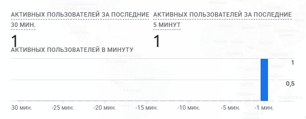
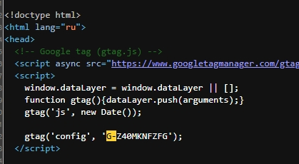
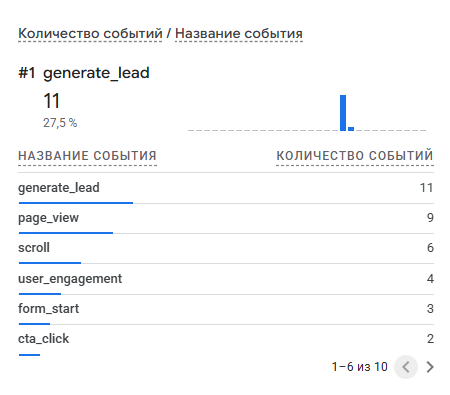
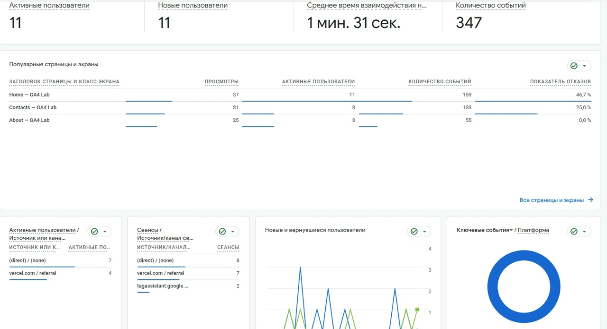

Домашняя работа № 3
Дисциплина: ОП.03 «Информационные технологии»

| Поле | Значение |
| :--- | :--- |
| Фамилия, имя | Перфильева Арина |
| Группа | РПО1 |
| Номер работы | 3 |
| Тема работы | Установка Google Tag, источник перехода и отчёты GA4 |
| Дата сдачи | 23.09 |
| Ветка | hw-03 |

---

## 1. Мой сайт и мой ресурс

| Поле | Значение |
| --- | --- |
| Адрес репозитория сайта | https://github.com/syrmaka/ga4-analytics-lab-perfileva |
| Публичный адрес сайта | https://ga4-analytics-lab-perfileva-is7i.vercel.app/index.html |
| Статус публикации | READY |
| Analytics Account | syrmaka |
| Property | ByteCamp Website |
| Stream name | Student Analytics Website |
| Website URL в потоке | https://ga4-analytics-lab-perfileva.vercel.app |
| Measurement ID (G-...) | G-Z40MKNFZFG |
| Страницы с тегом | все страницы сайта |

---

## 2. Тег установлен

---

## 3. События доходят до аналитики

| Поле | Значение |
| --- | --- |
| Дата и время проверки | 23.09 18:44 |
| Какие страницы открывали | Home, About |
| Какие события появились в Realtime | generate_lead, page_view, scroll, user_engagement, form_start, cta_click |
| Число активных пользователей в момент проверки | 1 |

---

## 4. Статистика на странице «Отчёты»

| Показатель | Значение | Период |
| :--- | :--- | :--- |
| Пользователи | 11 | Последние 28 дней |
| Сеансы | 17 | Последние 28 дней |
| События | 347 | Последние 28 дней |
| Самое частое событие | page_view | Последние 28 дней |

### По этим числам видно:

- **Масштаб аудитории** — метрика «Пользователи» отражает количество уникальных посетителей страницы «Отчёты» за выбранный период.  
- **Активность и вовлечённость** — соотношение «Сеансы / Пользователи» позволяет оценить повторные визиты: значение больше 1 говорит о том, что часть аудитории возвращалась на страницу.  
- **Ключевые действия** — «Самое частое событие» указывает на доминирующий тип взаимодействия (например, `page_view`, `click`), что помогает выявить основные сценарии поведения пользователей на странице.

## 5. Использование ИИ

| Вопрос | Ответ |
| --- | --- |
| Что сделано самостоятельно | Установлены теги, проверены и сняты кадры |
| Что спрошено у модели | Поиск метрик в GA4, оформление таблицы и интерпретации данных |
| Что после этого изменено | Скорректированы формулировки для лаконичности, адаптировано под .md-формат |