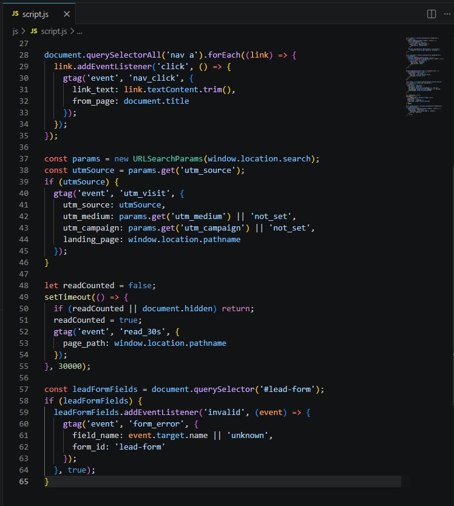
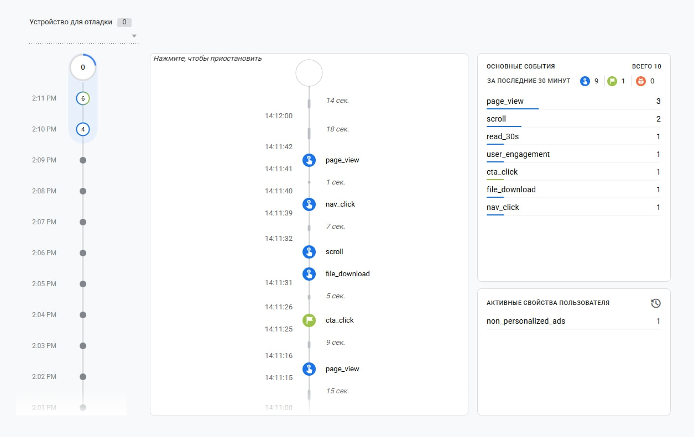
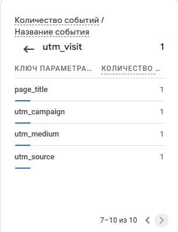
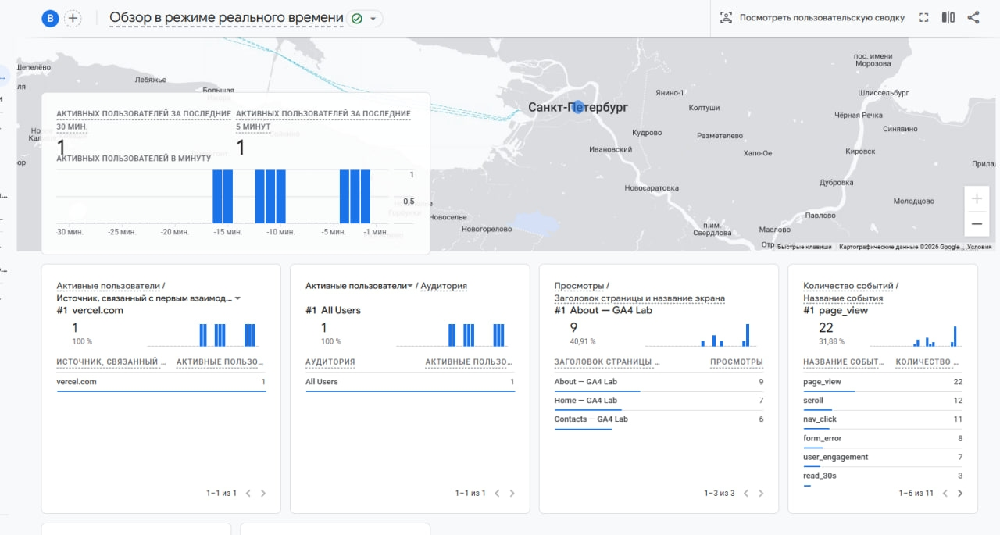

Домашняя работа № 4
Дисциплина: ОП.03 «Информационные технологии»

| Поле | Значение |
| :--- | :--- |
| Фамилия, имя | Перфильева Арина |
| Группа | РПО1 |
| Номер работы | 4 |
| Тема работы | Свои события и параметры: четыре метрики на сайте |
| Дата сдачи | 25.09 |
| Ветка | hw-04 |

---

# 1. Мой сайт и мой ресурс

| Поле | Значение |
| :--- | :--- |
| Публичный адрес сайта | https://ga4-analytics-lab-perfileva.vercel.app |
| Measurement ID ( G-... ) | G-Z40MKNFZFG |
| Коммит с метриками (ссылка или первые 7 символов) | metriki |
| Статус публикации | READY |
| Страницы, где подключён js/metrics.js | Все страницы (index.html, about.html, contacts.html) |

---

## 2. Какие метрики добавлены

| Событие | Что измеряет | Что делали, чтобы оно сработало |
| :--- | :--- | :--- |
| `nav_click` | клики по пунктам меню | Нашли ссылки в меню и повесили на них обработчик клика, который отправляет событие в GA4 |
| `utm_visit` | метки кампании из адреса | Считали UTM-метки из URL и, если они есть, отправили событие с этими данными |
| `read_30s` | полминуты на странице | Запустили таймер на 30 секунд и отправили событие, если вкладка активна |
| `form_error` | форма не прошла проверку браузера | Повесили слушатель ошибок на форму и отправляем событие с именем поля |

---

## 3. События в DebugView

| Поле | Значение |
| :--- | :--- |
| Дата и время проверки | 25.09, 14:11 |
| Как подключали отладку | Tag Assistant |
| Какие из четырёх событий пришли | `read_30s`, `nav_click`, `cta_click`, `page_view` |
| Какие не пришли и почему | `utm_visit` и `form_error` не пришли. `utm_visit` — потому что сайт открывался без UTM-меток в адресе. `form_error` — потому что не была отправлена форма с ошибкой валидации |

---

## 4. Параметры события `utm_visit`

| Параметр | Значение в ссылке | Значение в GA4 |
| :--- | :--- | :--- |
| `utm_source` | test | test |
| `utm_medium` | test | test |
| `utm_campaign` | test | test |
| `landing_page` | — | Не пришло (вместо него `page_title`) |

---

## 5. Событие вне отладки

| Поле | Значение |
| :--- | :--- |
| Где проверяли | Realtime / Отчёты → Взаимодействие → События |
| Какое событие искали | `nav_click` |
| Сколько срабатываний показал экран | 11 |
| Период (для отчёта) | Последние 30 минут |

---

## 6. Что эти метрики показывают про сайт

1. **`nav_click`** — видно, какие разделы меню популярнее у посетителей.
2. **`read_30s`** — показывает, задерживаются ли люди на странице дольше 30 секунд.
3. **`form_error`** — показывает, на каких полях формы пользователи чаще ошибаются.
4. **`utm_visit`** — помогает понять, из каких источников приходят посетители.

---

## 7. Что не получилось

Параметр `landing_page` в событии `utm_visit` не отобразился в GA4 — вместо него автоматически подставился `page_title`. Это особенность GA4: кастомные параметры не видны в отчётах без отдельной регистрации. Остальные события (`nav_click`, `read_30s`, `form_error`) сработали корректно.

---

## 8. Использование ИИ

| Вопрос | Ответ |
| :--- | :--- |
| Что сделано самостоятельно | Подключила `gtag.js`, настроила `debug_mode`, задеплоила сайт на Vercel, проверила события в DebugView и Realtime. |
| Что спрошено у модели | Как включить отладку без расширения Chrome, почему не приходит `utm_visit`. |
| Что после этого изменено | Проверила потерю UTM-меток при редиректе. |