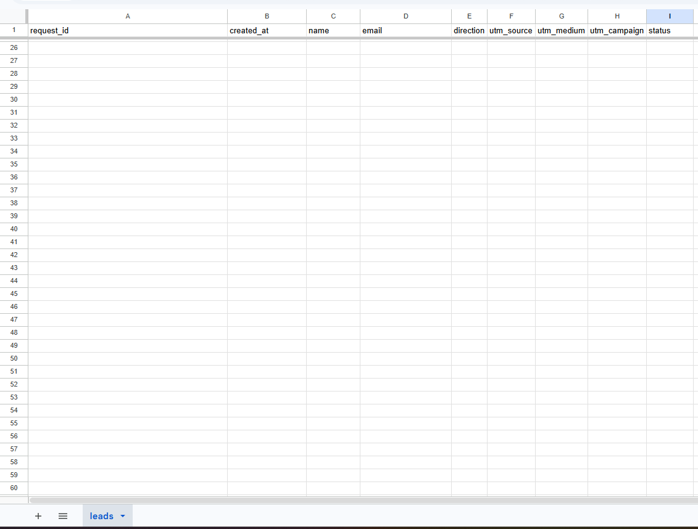
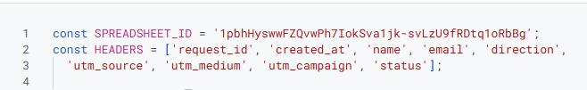
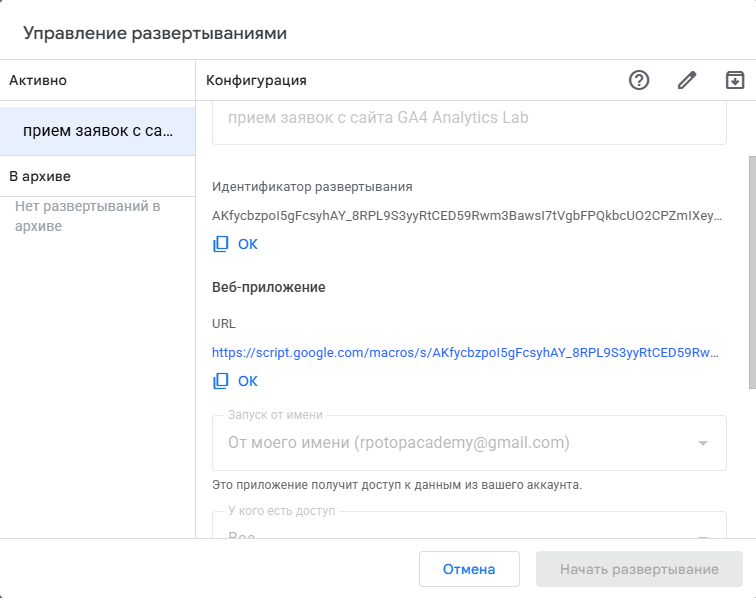
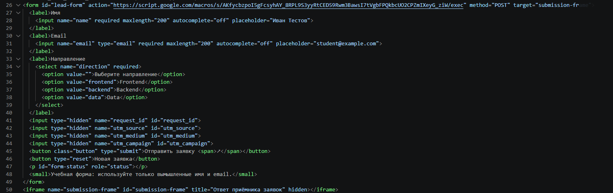
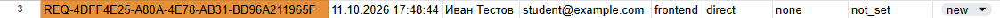
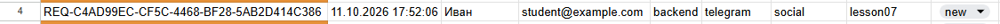
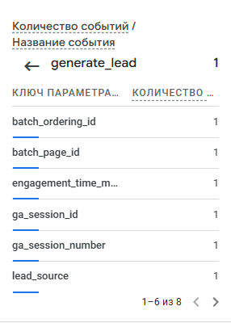
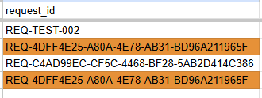
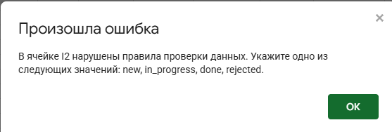

# Домашняя работа № 5
**Дисциплина:** ОП.03 «Информационные технологии»

## Общие сведения

| Поле | Значение |
| :--- | :--- |
| Фамилия, имя | Перфильева Арина |
| Группа | РПО1 |
| Номер работы | 5 |
| Тема работы | Форма сайта → Apps Script → Google Таблица заявок |
| Дата сдачи | 30.09 |
| Ветка | hw-05 |

---

## 1. Google Таблица «GA4 Analytics Lab — Leads»

Создана таблица **«GA4 Analytics Lab — Leads»** с листом `leads`.

### Структура листа

В первой строке — 9 заголовков:

- `request_id`
- `created_at`
- `name`
- `email`
- `direction`
- `utm_source`
- `utm_medium`
- `utm_campaign`
- `status`

### Реализованные настройки

- Строка заголовков **закреплена**.
- В столбце `status` — выпадающий список из 4 значений: `new`, `in_progress`, `done`, `rejected`.
- Два правила условного форматирования:
  - подсветка **неполной строки** (если есть пустые обязательные ячейки);
  - подсветка строки при **повторном** `request_id`.

**Ссылка на таблицу:** https://docs.google.com/spreadsheets/d/1pbhHyswwFZQvwPh7IokSva1jk-svLzU9fRDtq1oRbBg/edit?usp=sharing

---

## 2. Приёмник данных (Apps Script) и форма на сайте

### Реализация на стороне Apps Script

- В проект вставлен файл `Code.gs` из материалов.
- В коде указан **ID моей таблицы**.
- Проект опубликован как **Web app** (доступ: «Anyone with the link»).

  

### Интеграция формы

- В файле `contacts.html` форма заменена фрагментом из материалов; в атрибуте `action` установлен адрес моего Web app.
- Обработчик формы в `js/script.js` заменён на новый вариант.

| Параметр | Значение |
| :--- | :--- |
| Публичный адрес сайта | `https://ga4-analytics-lab-perfileva-is7i.vercel.app` |
| Measurement ID (G‑…) | G-Z40MKNFZFG |
| Коммит с новой формой (первые 7 символов) | Topic 7 |

---

## 3. Тестовые заявки

Выполнено 2 тестовые отправки формы для проверки корректности передачи данных.

### Заявка без меток

- Отправлена со страницы **без UTM‑меток**.
- В таблице записано: `direct / none / not_set`.
- Статус: `new`.
- `request_id`: `REQ-4DFF4E25-A80A-4E78-AB31-BD96A211965F`.

### Заявка с метками

- Отправлена по ссылке с метками: `telegram / social / lesson07`.
- Метки корректно записаны в столбцы `utm_source`, `utm_medium`, `utm_campaign`.
- Статус: `new`.
- `request_id`: `REQ-C4AD99EC-CF5C-4468-BF28-5AB2D414C386`.

  

---

## 4. Событие в Google Analytics 4

После отправки формы в GA4 фиксируется событие `generate_lead`.

- Событие отражает **попытку отправки** формы.
- Факт создания заявки подтверждается появлением строки в Google Таблице.

---

## 5. Проверки и валидация

Проведены проверки корректности работы логики и ограничений.

1. **Пустое имя.** Форма с пустым полем `name` не отправляется — валидация на стороне клиента работает.
2. **Повторная отправка без сброса.** При повторной отправке без активации «Новая заявка» новая строка в таблицу не добавляется.
3. **Дубликат `request_id`.** При копировании строки с тем же `request_id` срабатывает условное форматирование: строка подсвечивается как дубликат. После проверки строка была удалена.
4. **Недопустимый статус.** Попытка вручную ввести статус `finished` (не из списка) блокируется таблицей. Корректное изменение статуса выполняется через выпадающий список: `new → in_progress → done`.

  

